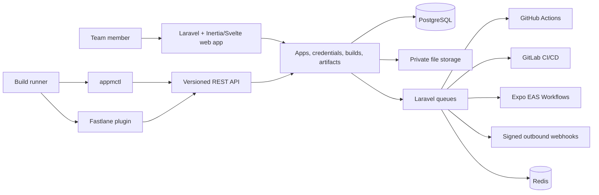

# App Manager

[](https://github.com/karerckor/app-manager/actions/workflows/platform-ci.yml)
[](https://github.com/karerckor/app-manager/pkgs/container/app-manager-platform)
[](LICENSE)

App Manager is a self-hosted control plane for application configuration, signing credentials, CI/CD builds, logs, and artifacts. It gives teams one place to manage iOS, Android, and Web application metadata and makes that data available to build runners through a versioned API, a dependency-light CLI, and composable Fastlane actions.

The project is aimed at teams that maintain multiple mobile applications, environments, or white-label variants and want to keep build configuration out of individual repositories and CI-provider-specific scripts.

> [!IMPORTANT]
> App Manager is under active development. It ships a container image and a Compose stack you can run, but not a stable release contract. Review the [production notes](#production-notes) before using it with real signing material.

## Run with Docker

```bash
mkdir app-manager && cd app-manager
curl -O https://raw.githubusercontent.com/karerckor/app-manager/main/deploy/docker/compose.yaml
curl -o .env https://raw.githubusercontent.com/karerckor/app-manager/main/deploy/docker/.env.example
echo "APP_KEY=$(docker run --rm --entrypoint app-manager ghcr.io/karerckor/app-manager-platform:latest generate-key)" >> .env
docker compose up -d
```

Open <http://localhost:8000>. See [`deploy/docker`](deploy/docker/README.md) for the startup
presets — installer, env-provided admin, or demo data — and the credential storage modes.

## What it provides

- A multi-team web application with registration, login, two-factor authentication, invitations, and role-based permissions.
- Application records with iOS bundle identifiers, Android package names, Web domains, versions, icons, splash screens, and tags.
- Typed signing and service credentials for Apple, Android, Firebase, APNs, App Store Connect, and Google Play.
- GitHub Actions, GitLab CI/CD, and Expo EAS Workflows connections with project/repository, pipeline, ref, and input discovery.
- Automatic builds, where App Manager dispatches a provider pipeline and reconciles its state, and manual builds, where a runner reports lifecycle and logs through the API.
- Build history, cancellation, plain-text logs, immutable build parameters, and downloadable artifacts.
- Scoped team API keys, outbound signed webhooks, delivery history, redelivery, and a team audit log.
- Two CI clients: the `appmctl` Bash CLI and `fastlane-plugin-app_manager` Ruby gem.

## Repository status

App Manager currently works best as an internal tool or a foundation for a hosted product. [`deploy/docker`](deploy/docker/README.md) covers deployment, upgrades, and backups, but versioned releases, upgrade guarantees, and an end-user support policy are not established yet.

Interfaces may change while the API and clients are still pre-1.0.

## Architecture



The platform is the source of truth. CI clients never need direct database or storage access: they authenticate with a team-scoped API key and use `/api/v1/{team_slug}`. The web application applies team roles and permissions; the API applies both the API key's scopes and the permissions of the user who created that key.

## Repository layout

| Path | Purpose |
| --- | --- |
| [`apps/platform`](apps/platform) | Laravel 13 application, REST API, queue workers, Inertia.js, and Svelte 5 UI |
| [`apps/platform/docs/api-v1.md`](apps/platform/docs/api-v1.md) | Detailed API v1 endpoint and payload reference |
| [`libs/cli`](libs/cli) | Bash 3.2-compatible API client and live build-log streamer |
| [`libs/fastlane-plugin`](libs/fastlane-plugin) | Fastlane actions for metadata, assets, credentials, build reporting, and artifacts |
| [`demos/expo-hello-world`](demos/expo-hello-world) | Expo app demonstrating configuration and credential preparation plus Fastlane integration |
| [`.github/workflows`](.github/workflows) | Android and iOS plugin smoke workflows |
| [`deploy/docker`](deploy/docker/README.md) | Self-hosting Compose stack, environment reference, and stack smoke test |
| [`docker-compose.yml`](docker-compose.yml) | Local PostgreSQL and Redis services |
| [`docs/superpowers`](docs/superpowers) | Historical implementation designs and plans, not the public user guide |

## Core concepts

### Teams and access

Every application, API key, integration, credential, build, and webhook belongs to a team. Members have one of four roles:

| Role | Intended access |
| --- | --- |
| Owner | All team capabilities, including closing the team |
| Admin | Team, application, credential, integration, and pipeline management |
| Contributor | Read access plus credential management |
| Viewer | Read-only access |

API keys also carry explicit resource scopes. A request is allowed only when the key has the required scope and its creator has the corresponding team permission. Tenant-bound route resolution returns `404` for resources outside the selected team rather than exposing their existence.

### Applications, identifiers, and profiles

A mobile app is the product-level record. Each app can have multiple platform identifiers, for example production and beta bundle IDs:

- iOS identifiers contain a bundle ID and optional version.
- Android identifiers contain a package name, optional version, and positive integer `version_code`.
- Web identifiers contain a domain or subdomain and optional version. They do not use platform credentials.

Signing credentials are attached through build profiles. Supported profiles are:

| Platform | Profiles | Typical output |
| --- | --- | --- |
| iOS | `development`, `adhoc`, `appstore`, `enterprise` | `.ipa` |
| Android | `development`, `preview`, `production` | `.apk` or `.aab` |

Service credentials that are not profile-specific attach directly to an app identifier.

### Credentials

The current credential catalog includes:

- iOS signing certificates and provisioning profiles;
- Android keystores;
- APNs authentication keys;
- App Store Connect API keys;
- Firebase HTTP v1 service accounts;
- Google Play service accounts;
- Android `google-services.json` and iOS `GoogleService-Info.plist` client configuration.

Credential metadata and payload fields are validated by type. Sensitive payloads are encrypted in the database with the Laravel application key and excluded from audit diffs. Uploaded files use private storage and are downloaded only through authorized application routes.

### Builds

App Manager supports two reporting modes:

- `automatic`: App Manager dispatches a configured GitHub, GitLab, or Expo EAS Workflow pipeline and synchronizes provider status and logs/job summaries.
- `manual`: App Manager or a runner creates the build, and the runner updates status and appends logs through API clients.

The selected reporting mode is snapshotted onto each build. Manual lifecycle writes are rejected for automatic builds. Build creation is idempotent by team and `request_uuid`, and terminal state transitions are protected from conflicting rewrites.

Completed build logs are retained in the database for 30 days by default. The daily `build-logs:archive` task then moves them to the configured private media storage (local or S3), while authorized users can still download the original `.log` file from the build page or API. Set `BUILD_LOG_RETENTION_DAYS` to change the retention window, and keep the Laravel scheduler running in every deployment.

### Webhooks and auditing

Domain events are recorded in an outbox and delivered asynchronously to subscribed webhook endpoints. Endpoint secrets are shown when created or rotated, payloads are signed, delivery attempts are retained, and failed deliveries can be inspected or replayed. Private-network webhook targets are rejected by default.

The audit log records actor, source, team, request context, and model changes while excluding credential payloads, integration tokens, API key material, and webhook secrets.

## Requirements

For the platform:

- PHP 8.4 or later and Composer 2;
- Node.js 22.13 or later and npm;
- PostgreSQL 17 and Redis 8, or Docker with Compose;
- PHP extensions required by Laravel, PostgreSQL, and Redis.

For the optional clients and demo:

- Bash 3.2+, `curl`, and `jq` for all CLI features;
- Ruby 3.1+ and Bundler for the Fastlane plugin;
- pnpm for the Expo demo's `prepare` script;
- Xcode for real iOS builds and Android SDK/JDK tooling for real Android builds.

## Local quick start

Start PostgreSQL and Redis from the repository root:

```bash
docker compose up -d
```

Install and initialize the platform:

```bash
cp apps/platform/.env.example apps/platform/.env
cd apps/platform

composer install
npm install
php artisan key:generate
php artisan migrate
```

For OAuth callbacks and generated absolute URLs, set `APP_URL=http://localhost:8000` in `apps/platform/.env`.

Start the application server, Vite, queue worker, scheduler, and log viewer together:

```bash
composer run dev
```

Open [http://localhost:8000](http://localhost:8000). The one-time self-hosted installer checks the server, creates the first owner and team, and optionally configures GitHub, GitLab, and outbound webhooks. Integration secrets are encrypted in the database with `APP_KEY`; after setup, the installer and public registration are locked.

### Private file storage

Local development uses the private filesystem under `storage/app/private`. New media is never written to Laravel's public disk, and credential, asset, and artifact downloads are streamed through authorized application routes. Credential files are additionally encrypted by the application before they reach local or S3 storage. After upgrading an existing installation, run `php artisan credentials:encrypt-files --dry-run` and then `php artisan credentials:encrypt-files` to encrypt legacy plaintext credential media.

The self-hosted installer lets the first owner select either the local private filesystem or an S3-compatible bucket. It verifies write, read, and delete access before completing installation, then stores any supplied object-storage credentials inside the encrypted installation settings.

The hosted/SaaS distribution is configured exclusively through environment variables:

```dotenv
MEDIA_STORAGE_DRIVER=s3
MEDIA_S3_REGION=eu-central-1
MEDIA_S3_BUCKET=app-manager-private
MEDIA_S3_PREFIX=production/media

# Prefer an IAM role and leave these empty when running on AWS.
MEDIA_S3_ACCESS_KEY_ID=
MEDIA_S3_SECRET_ACCESS_KEY=
MEDIA_S3_SESSION_TOKEN=

# Leave both values empty/default for AWS S3.
MEDIA_S3_ENDPOINT=
MEDIA_S3_USE_PATH_STYLE_ENDPOINT=false
MEDIA_S3_OBJECT_ACL=bucket-owner-full-control

# Server-side encryption is enabled by default in addition to application encryption.
MEDIA_S3_SERVER_SIDE_ENCRYPTION=aws:kms
MEDIA_S3_KMS_KEY_ID=arn:aws:kms:eu-central-1:123456789012:key/example
```

For DigitalOcean Spaces, set the regional endpoint, such as `https://nyc3.digitaloceanspaces.com`, leave path-style addressing disabled, and use `MEDIA_S3_OBJECT_ACL=private`. For MinIO, set its HTTP or HTTPS endpoint, use the private ACL, and normally set `MEDIA_S3_USE_PATH_STYLE_ENDPOINT=true`. Other S3-compatible services can use the same endpoint, ACL, and path-style settings. Keep the bucket private; public object URLs are not used.

To keep files on a mounted local volume in SaaS or an externally provisioned self-hosted deployment:

```dotenv
MEDIA_STORAGE_DRIVER=local
MEDIA_LOCAL_ROOT=/var/lib/app-manager/media
```

Every media database row retains its concrete disk name, so local and S3-backed records can coexist during a controlled migration. Changing the active driver affects new uploads; existing objects must still remain available on their original disk until copied.

To load local demo data instead, run:

```bash
php artisan db:seed
```

Then use the seeded development account:

```text
Email:    demo@example.com
Password: Demo123!
```

The seed also creates:

```text
Team:     demo-users-team
App:      example-app
API key:  demo-api-key
```

The generated Android and iOS signing files are structurally valid local fixtures. Apple and the application stores do not trust them; replace them before testing a real release.

### Verify the API

```bash
curl http://localhost:8000/api/v1/demo-users-team/apps \
  -H 'Authorization: Bearer demo-api-key' \
  -H 'Accept: application/json'
```

Or use the repository CLI:

```bash
export APP_MANAGER_API_KEY=demo-api-key
export APP_MANAGER_TEAM=demo-users-team

libs/cli/bin/appmctl --json request GET apps
```

## API overview

All API endpoints are rooted at:

```text
https://manager.example.com/api/v1/{team_slug}
```

Requests use a bearer API key:

```http
Authorization: Bearer 1|plain-text-api-key
Accept: application/json
```

The API covers the following resource groups:

| Resource | Examples | Scopes |
| --- | --- | --- |
| Applications | CRUD and tags | `apps:read`, `apps:write` |
| Identifiers | iOS/Android identifiers and versions | `identifiers:read`, `identifiers:write` |
| Assets | Icon and splash screen upload/download | `assets:read`, `assets:write` |
| Credentials | Typed secrets and files | `credentials:read`, `credentials:write` |
| Builds and logs | Manual lifecycle, automatic runs, cancellation | `builds:*`, `logs:*`, `pipelines:run` |
| Artifacts | Upload, list, download, delete | `artifacts:read`, `artifacts:write` |
| Integrations and pipelines | Discovery and configuration | `integrations:read`, `pipelines:*` |
| Webhooks | Endpoints, deliveries, testing, redelivery | `webhooks:*`, `deliveries:read` |
| API keys | Team key creation and revocation | `api-keys:read`, `api-keys:write` |

See the [API v1 reference](apps/platform/docs/api-v1.md) for request fields, response behavior, limits, and examples.

## CLI

`appmctl` is a single Bash executable intended for local automation and CI images where installing a language-specific SDK is undesirable.

```bash
APPMCTL_SHA256='PUBLISHED_SHA256_FOR_THIS_RELEASE'
curl -fsSL \
  https://raw.githubusercontent.com/karerckor/app-manager/main/libs/cli/install.sh |
  APPMCTL_SHA256="$APPMCTL_SHA256" bash

export PATH="${HOME}/.local/bin:${PATH}"
export APP_MANAGER_API_KEY='1|plain-text-api-key'
export APP_MANAGER_TEAM='mobile-team'
export APP_MANAGER_APP='customer-app'
export APP_MANAGER_INSTANCE_URL='https://manager.example.com'

appmctl --json request GET apps
appmctl stream --build-id "$APP_MANAGER_BUILD_ID" --step Build -- pnpm build
```

The installer requires a SHA-256 checksum and can also pin a commit. The CLI supports generic JSON and multipart requests, binary downloads, dry runs with secret redaction, and live log streaming that preserves the wrapped command's exit status.

Read the complete [App Manager CLI guide](libs/cli/README.md).

## Fastlane plugin

The Fastlane plugin exposes typed, composable actions instead of prescribing one mobile build stack. A lane can download exactly the files it needs and combine them with native, Flutter, React Native, or Expo build steps.

```ruby
app_manager_configure(
  api_key: ENV.fetch("APP_MANAGER_API_KEY"),
  base_url: ENV.fetch("APP_MANAGER_BASE_URL"),
  team: ENV.fetch("APP_MANAGER_TEAM"),
  app: ENV.fetch("APP_MANAGER_APP")
)

keystore = app_manager_download_android_keystore(
  profile_type: "production",
  output_path: "android/app/release.jks"
)

app_manager_build_start
app_manager_build_log(message: "Building Android release")
```

The plugin also loads app metadata, downloads assets and Apple/Google service keys, creates manual builds, finishes build states, and uploads artifacts.

Read the complete [Fastlane plugin guide](libs/fastlane-plugin/README.md).

## Expo demonstration

The [Expo Hello World demo](demos/expo-hello-world/README.md) shows a complete configuration-preparation flow:

```bash
cd demos/expo-hello-world
npm install --ignore-scripts
npm run prepare
npm test
```

`prepare` reads the seeded app, identifiers, assets, and credentials; generates Expo and Fastlane context files; and writes secret files with restrictive permissions. The GitHub workflows use the real plugin client against a local mock API unless a live App Manager URL and API key are supplied.

## Integrations

For a new self-hosted instance, configure integrations in the web installer; it encrypts provider secrets with `APP_KEY`. The environment variables below remain available for legacy or externally provisioned deployments where `SELF_HOSTED_INSTALLER_ENABLED=false`:

```dotenv
INTEGRATIONS_ENABLED=true

GITHUB_INTEGRATION_ENABLED=true
GITHUB_APP_ID=
GITHUB_APP_CLIENT_ID=
GITHUB_APP_CLIENT_SECRET=
GITHUB_APP_SLUG=
GITHUB_APP_PRIVATE_KEY=
GITHUB_APP_WEBHOOK_SECRET=

GITLAB_INTEGRATION_ENABLED=true
GITLAB_SELF_HOSTED_ENABLED=true
GITLAB_OAUTH_CLIENT_ID=
GITLAB_OAUTH_CLIENT_SECRET=

OUTBOUND_WEBHOOKS_ENABLED=true
```

GitHub uses a GitHub App and receives provider events at `/webhooks/github`. The shared GitLab provider uses OAuth; workspace admins can also connect multiple self-hosted GitLab URLs with personal access tokens from the Integrations page. Provider access, refresh, and personal access tokens are stored encrypted. See the [GitLab integration notes](apps/platform/docs/gitlab-integration.md) for callback configuration and CI input requirements.

Integration, webhook, and default queue jobs must be processed for dispatch, reconciliation, and delivery to work. `composer run dev` starts the required worker and scheduler locally.

## Testing

Run the platform suite and frontend production build:

```bash
cd apps/platform
composer test
npm run build
```

Run the CLI smoke tests from the repository root:

```bash
bash -n libs/cli/bin/appmctl
bash libs/cli/tests/test_cli.sh
bash -n libs/cli/install.sh
bash libs/cli/tests/test_install.sh
```

Run the Fastlane plugin suite:

```bash
cd libs/fastlane-plugin
bundle install
bundle exec rspec
gem build fastlane-plugin-app_manager.gemspec
```

Run the Expo preparation tests:

```bash
cd demos/expo-hello-world
npm test
```

## Production notes

[`deploy/docker`](deploy/docker/README.md) provides the runnable parts of a deployment: durable PostgreSQL, Redis and file storage volumes, long-running web, queue and scheduler processes, optional TLS termination through Caddy, an upgrade command, and backup commands for the database and the storage volume.

An operator still has to supply:

- transactional mail for verification, password reset, and invitations;
- offsite retention for those backups, and restore testing;
- monitoring for queue failures, webhook delivery, provider API errors, disk usage, and credential expiry;
- a rollback path — pin an image tag rather than tracking `latest`, and take a database dump before every upgrade.

Security-sensitive considerations:

- Keep `APP_KEY` stable, access-controlled, and backed up. Database-encrypted credentials and OAuth tokens depend on it.
- Credential payloads are application-encrypted. Uploaded files use private local or S3-compatible storage and can request SSE-S3/SSE-KMS, but they are not application-level envelope-encrypted blobs. Keep the bucket private, restrict its IAM policy, and add client-side encryption before treating the platform as a signing vault whose storage operator is outside the trust boundary.
- Use least-privilege API keys. A build runner normally needs only the scopes used by that pipeline.
- Use HTTPS for every non-local connection and never expose the seeded demo credentials.
- Keep `WEBHOOKS_ALLOW_PRIVATE_ADDRESSES=false` unless private destinations are an intentional, controlled requirement.
- Review provider permissions, token rotation, audit retention, backup encryption, and deletion semantics for your compliance needs.

## Contributing and releases

Contributions are welcome. Read [CONTRIBUTING.md](CONTRIBUTING.md) for setup, testing, commit, and pull-request guidance. By participating, you agree to follow the [Code of Conduct](CODE_OF_CONDUCT.md). Security issues should be reported privately as described in [SECURITY.md](SECURITY.md).

Version tags (`v*`) create a GitHub release and publish a multi-architecture container image. Development builds from `main` are tagged `edge`; stable releases also publish `latest` and semantic-version tags.

## License

App Manager is available under the [MIT License](LICENSE).
