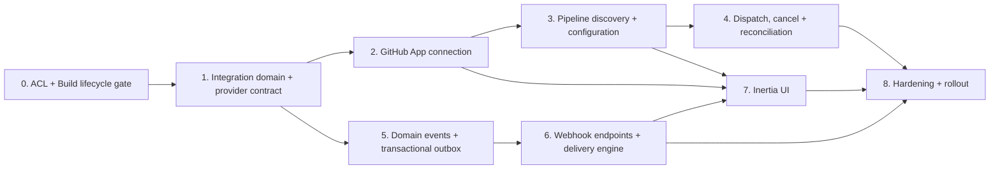

# Integrations: GitHub CI/CD and outbound webhooks — implementation plan

**Date:** 2026-07-18

**Design:** [`../specs/2026-07-18-integrations-github-webhooks-design.md`](../specs/2026-07-18-integrations-github-webhooks-design.md)

**Branch baseline:** created from `main` at `0636326`, updated to `main` at `e5b30a8`

**Target:** Laravel 13 / Inertia / Svelte 5 platform in `apps/platform`

**Implementation status:** The core paths across Tasks 0–7 and their automated
checks are implemented on `codex/integrations-github-webhooks`. Manual delivery
replay/retention and team invitation/member event producers remain pending;
the latter have no corresponding product mutation lifecycle on `main`, while
their v1 event names are already reserved.

## Goal

Ship an Owner/Admin-only Integrations area that connects a team to a GitHub App
installation, configures GitHub Actions workflows as application build
pipelines, starts/cancels and reconciles builds, and sends signed outbound
webhooks for application, build, invitation, and membership events.

## Delivery shape

The work is split into independently reviewable slices. GitHub and outbound
webhook work can proceed in parallel after the common domain and ACL contract is
landed.



## Suggested team allocation and estimate

These are engineering estimates, not calendar commitments. They exclude delays
for GitHub organization approval and production secret provisioning.

| Workstream | Suggested owner | Tasks | Estimate |
|---|---|---|---:|
| Foundations / integration domain | Backend A | 0–1 | 4–7 engineer-days |
| GitHub provider / build lifecycle | Backend A after Task 1 | 2–4 | 10–15 engineer-days |
| Outbound webhooks | Backend B | 5–6 | 7–11 engineer-days |
| Inertia UI / end-to-end flows | Full-stack / frontend | 3 UI contract, 7 | 5–8 engineer-days |
| Security, QA, operations | Shared | 8 plus reviews throughout | 3–5 engineer-days |

With three engineers, the expected elapsed time after the ACL/build dependency
is ready is roughly **3–4 weeks**. The critical path is GitHub connection →
pipeline configuration → dispatch/reconciliation. Webhook backend work is not
on that critical path until the shared UI and release-hardening phase.

## Global implementation constraints

- All team resources are scope-bound by `{team:slug}` and verified again in
  policies/application services.
- `manage_integrations` and `run_pipelines` are granted only to Owner/Admin for
  this release.
- Provider HTTP calls run after commit on queues, never inside a user-facing
  database transaction.
- No PAT, GitHub user token, installation token, credential payload, or webhook
  secret may appear in logs, exceptions, build snapshots, or outbound events.
- Controllers stay thin. Provider branching lives in a registry/adapter, build
  transitions in the build lifecycle service, and event production in explicit
  application actions.
- Outbound domain events are not produced by generic Eloquent observers. Each
  mutation records an event with an intentional safe projection in its own
  transaction.
- Every external side effect has an idempotency/deduplication story and a test
  for duplicate or out-of-order processing.
- PostgreSQL and Redis are production dependencies; fast unit/feature tests may
  use the existing test database, but concurrency-sensitive paths require at
  least one PostgreSQL integration test in CI.

---

## Task 0 — Reconcile ACL, invitations, and build lifecycle

- **Owner:** Foundations
- **Depends on:** parallel ACL/build work or a product decision to implement
  the minimum directly
- **Estimate:** 2–4 engineer-days

### Files/contracts

- Modify or add `app/Enums/TeamRole.php` and `app/Enums/TeamPermission.php`.
- Modify `app/Policies/TeamPolicy.php` and shared Inertia permissions.
- Reconcile `app/Enums/BuildStatus.php`, `app/Models/BuildRecord.php`, and
  `app/Support/Builds/BuildLifecycle.php` when those files land.
- Reconcile team invitation/member application services and policies.
- Tests: `tests/Feature/TeamAclTest.php`, build lifecycle tests, invitation and
  member removal tests.

### Steps

- [ ] Rebase this worktree on the `main` commit that contains accepted ACL,
  invitations, and build lifecycle work. Do not copy uncommitted files from the
  other worktree.
- [ ] Add `ManageIntegrations = 'manage_integrations'` and
  `RunPipelines = 'run_pipelines'`; grant both only to Owner and Admin.
- [ ] Expose both permissions through Inertia using the existing permission
  serialization and verify unknown roles fail closed.
- [ ] Ensure a build can represent `cancel_requested` separately from terminal
  `cancelled`, either as a status or an explicit lifecycle attribute.
- [ ] Ensure build start/finish/cancel transitions are idempotent under row lock
  and reject invalid terminal rewrites.
- [ ] Ensure invitation create/accept/revoke, member role change, and member
  removal run through explicit services/actions that can add an outbox event in
  the same transaction.
- [ ] Add authorization matrix tests for direct web/API calls by all four roles.

### Exit criteria

- Owner/Admin pass both new permissions; Contributor/Viewer fail them.
- Build and team-access mutations have a stable service boundary used by later
  tasks.
- No integration code depends on an uncommitted schema from another worktree.

---

## Task 1 — Integration domain, schema, and provider contract

- **Owner:** Foundations
- **Depends on:** Task 0
- **Estimate:** 2–3 engineer-days

### Files

- Add enums:
  - `app/Enums/IntegrationKind.php`
  - `app/Enums/IntegrationProvider.php`
  - `app/Enums/IntegrationStatus.php`
  - `app/Enums/CiCdDispatchStatus.php`
- Add models/factories:
  - `app/Models/Integration.php`
  - `app/Models/CiCdPipeline.php`
  - `app/Models/CiCdRun.php`
- Add migrations for `integrations`, `ci_cd_pipelines`, and `ci_cd_runs`.
- Add provider boundary under `app/Integrations/CiCd/Contracts` and DTOs under
  `app/Integrations/CiCd/Data`.
- Add `app/Integrations/CiCd/CiCdProviderRegistry.php`.
- Modify `Team`, `MobileApp`, `AppIdentifier`, and `BuildRecord` relations.
- Tests: model relation/cascade tests, enum tests, registry tests, tenant scope
  tests.

### Steps

- [ ] Create UUID-backed, team-owned tables exactly as defined in the design.
  Use soft-disconnect/soft-delete for configuration while preserving historical
  build/provider evidence.
- [ ] Add composite indexes for team lists, active integration lookup, provider
  external IDs, pipeline app lookup, and non-terminal run reconciliation.
- [ ] Enforce application/identifier consistency in validation/application
  service and database-safe tests; an identifier from another app/team cannot
  be bound to a pipeline.
- [ ] Encrypt `input_defaults` and explicitly validate that the UI/API does not
  accept known secret fields or credential material.
- [ ] Define provider DTOs for repository, pipeline, ref, dispatch result,
  cancellation result, and normalized run status.
- [ ] Register providers through `CiCdProviderRegistry`; unknown/disabled
  providers fail with a typed domain exception.
- [ ] Add policies for integration, pipeline, and CI run actions using the new
  permissions.

### Exit criteria

- The domain supports a provider without any GitHub-specific columns outside
  provider resource snapshots.
- Cross-team model substitution is covered by tests and fails with 404/403 as
  appropriate.
- Disconnecting configuration does not delete `BuildRecord` or `CiCdRun`
  history.

---

## Task 2 — GitHub App connection and inbound webhook foundation

- **Owner:** GitHub backend
- **Depends on:** Task 1
- **Estimate:** 3–5 engineer-days

### Files

- Modify `config/services.php` and `.env.example` with GitHub App identifiers,
  private-key path/value, callback/setup URL, webhook secret, and pinned API
  version.
- Add `app/Integrations/CiCd/GitHub/GitHubClient.php`.
- Add `GitHubJwtFactory`, `GitHubInstallationTokenFactory`, DTO mapping, and
  typed exception/rate-limit mapping in the same namespace.
- Add connection state storage/action under
  `app/Integrations/CiCd/GitHub/Connection`.
- Add authenticated connect/callback/setup/disconnect/sync controllers under
  `app/Http/Controllers/Integrations`.
- Add inbound `GitHubWebhookController`, signature middleware/service, delivery
  receipt model/migration, and queued handler.
- Modify `routes/web.php`; keep the GitHub webhook route outside session/Sanctum
  middleware and exempt only that route from CSRF.
- Tests: `tests/Feature/Integrations/GitHubConnectionTest.php`,
  `GitHubWebhookTest.php`, and unit tests for JWT/signatures/error mapping.

### Steps

- [ ] Add configuration validation that fails clearly at boot/use time when the
  GitHub feature flag is enabled but secrets are missing.
- [ ] Implement App JWT and per-call installation token creation. Installation
  and user access tokens must remain in memory only.
- [ ] Create a single-use, expiring connection state bound to local user and
  team; reject missing, reused, expired, or cross-team state.
- [ ] Complete GitHub user authorization and verify the returned installation
  appears in the current GitHub user's accessible installation list before
  persisting it.
- [ ] Store only installation/account metadata and requested permission health;
  discard the GitHub user token after verification.
- [ ] Implement sync/disconnect. Disconnect disables pipelines and preserves
  history; it does not silently uninstall the external GitHub App.
- [ ] Verify inbound HMAC against the raw body with constant-time comparison,
  deduplicate `X-GitHub-Delivery`, return 202 promptly, and queue processing.
- [ ] Handle installation created/deleted/suspend/unsuspend and
  installation-repositories changes idempotently.
- [ ] Use `Http::fake()` contract tests to assert API version, accept header,
  bearer token, pagination, redacted errors, and rate-limit behavior.

### Exit criteria

- A forged setup `installation_id` cannot be attached to a team.
- Duplicate inbound deliveries are acknowledged once and processed once.
- Suspended/deleted installations block new work without deleting history.
- Tests prove no persistent token column exists and logs redact auth headers.

---

## Task 3 — Repository/workflow discovery and pipeline configuration

- **Owner:** GitHub backend with frontend contract review
- **Depends on:** Task 2
- **Estimate:** 3–4 engineer-days

### Files

- Extend `GitHubClient`/provider adapter with repository, workflow, ref, and
  workflow-content discovery.
- Add workflow parser/validator under
  `app/Integrations/CiCd/GitHub/GitHubWorkflowDefinition.php`.
- Add `symfony/yaml` only if no compatible YAML parser is already present after
  rebasing; lock and test the chosen parser behavior for the `on` key.
- Add requests/controllers/actions under
  `app/Http/Controllers/Integrations/CiCdPipelines` and
  `app/Actions/Integrations`.
- Add authenticated routes below `/accounts/{team:slug}/integrations/github`.
- Tests: discovery pagination/cache/error tests and pipeline CRUD policy/scope
  tests.

### Steps

- [ ] List only repositories granted to the selected installation.
- [ ] List active workflows and fetch the selected YAML on the default branch
  to verify `workflow_dispatch` exists, as required by GitHub. For a non-default
  run ref, inspect the same workflow at that ref as well.
- [ ] Parse the optional `workflow_dispatch.inputs` schema into name,
  description, required/default, and supported type/choices for the launch UI.
- [ ] Enforce GitHub's current input count and serialized payload-size limits in
  server-side validation; keep those limits covered by provider contract tests
  rather than assuming UI validation is sufficient.
- [ ] List branches/tags/refs with pagination and retain a manual ref field for
  valid refs not returned in the first page.
- [ ] Create/update pipeline configuration with immutable provider IDs plus
  display snapshots, application target, optional identifier, profile, default
  ref, and non-secret input defaults.
- [ ] Revalidate repository access and workflow availability on save and sync;
  mark unavailable resources rather than rebinding by name/path.
- [ ] Cache discovery briefly per installation/repository and expose explicit
  refresh; never cache installation access tokens.
- [ ] Cover renamed repository/workflow, removed access, disabled workflow,
  missing `workflow_dispatch`, foreign identifier, and cross-team IDs.

### Exit criteria

- Owner/Admin can configure only an accessible dispatchable workflow.
- Contributor/Viewer cannot enumerate repositories or configuration metadata.
- Saved IDs survive display-name/path changes and become visibly unavailable
  when the provider resource disappears.

---

## Task 4 — Build dispatch, cancellation, GitHub status, and reconciliation

- **Owner:** GitHub backend
- **Depends on:** Task 3 and stable BuildLifecycle from Task 0
- **Estimate:** 4–6 engineer-days

### Files

- Add `app/Actions/Integrations/StartPipelineBuild.php` and
  `RequestPipelineBuildCancellation.php`.
- Add `app/Jobs/Integrations/DispatchCiCdRun.php`, `CancelCiCdRun.php`, and
  `ReconcileCiCdRun.php` on the `integrations` queue.
- Extend the GitHub provider with dispatch, cancel, get-run, and normalized
  status mapping.
- Extend inbound GitHub webhook handling for `workflow_run`.
- Add scheduled reconciliation in `routes/console.php` or a dedicated command.
- Add web controllers/routes for run and cancel actions.
- Extend build resources/payloads with safe pipeline and provider-run links.
- Tests: `GitHubBuildDispatchTest.php`, `GitHubBuildCancellationTest.php`,
  `GitHubRunReconciliationTest.php`, and lifecycle concurrency/idempotency tests.

### Steps

- [ ] In one transaction authorize and validate the pipeline, snapshot build
  context, create one `BuildRecord` and one `CiCdRun(created)`, then enqueue
  dispatch after commit.
- [ ] Add a client-generated idempotency key/request UUID so duplicate browser
  submissions return the existing build instead of creating another local run.
- [ ] Lock the CI run before dispatch state changes. Move through
  `created → dispatching → accepted|unknown|failed` with compare-and-set or row
  locks.
- [ ] Mint an installation token in the job, dispatch workflow with ref/inputs,
  and store the returned GitHub run ID and URLs immediately.
- [ ] On network ambiguity after sending, set `unknown` and reconcile; never
  blindly retry the external dispatch.
- [ ] Translate workflow-run requested/in-progress/completed/conclusion values
  into idempotent BuildLifecycle transitions. Ignore stale regressions and
  duplicate terminal notifications.
- [ ] Request cancellation locally, call GitHub cancel, and wait for provider
  confirmation/reconciliation before setting terminal cancelled.
- [ ] Reconcile all accepted/unknown non-terminal runs on a schedule with
  jitter, backoff, rate-limit awareness, and a maximum stale-run alert.
- [ ] Validate webhook installation, repository, workflow, and external run ID
  ownership before mutating a build.
- [ ] Add tests for double click, queue retry, HTTP timeout ambiguity, duplicate
  and out-of-order GitHub events, cancel-vs-complete race, 409 cancel response,
  installation suspension, and provider rate limit.

### Exit criteria

- One accepted user request cannot automatically dispatch two GitHub runs.
- Product status converges correctly after missed/duplicate/out-of-order events.
- A run from another repository/team/installation cannot update a build.
- Owner/Admin see provider URL; sensitive inputs and tokens remain absent.

---

## Task 5 — Event catalog and transactional outbox

- **Owner:** Webhooks backend
- **Depends on:** Task 1 and the mutation service boundaries from Task 0
- **Estimate:** 3–5 engineer-days

### Files

- Add `app/Enums/WebhookEventType.php`.
- Add `app/Models/WebhookEvent.php` and its migration/factory.
- Add safe projection factories under
  `app/Webhooks/Events/Projections` and event envelope builder/publisher.
- Add outbox publishing job/command under `app/Jobs/Webhooks`.
- Modify explicit application actions for:
  - mobile app create/update/delete;
  - app identifier create/update/delete;
  - credential create/update/delete;
  - build create/start/cancel request/terminal completion;
  - invitation create/accept/revoke;
  - member role change/removal.
- Add JSON Schemas/fixtures under `contracts/webhooks/v1/`.
- Tests: `tests/Feature/Webhooks/WebhookEventOutboxTest.php` and schema fixture
  tests.

### Steps

- [ ] Define the exact v1 event enum and stable envelope from the design.
- [ ] Define an allow-listed projection per aggregate. Credential projection
  must be constructed without loading/decrypting `payload` where possible and
  must never contain file/download URLs.
- [ ] Capture delete tombstones and update changes before mutation, then insert
  the event inside the same transaction as the domain write.
- [ ] Include actor type/ID for user and API-token actions without exposing token
  names/secrets.
- [ ] Emit `build.completed` exactly once upon first terminal transition with
  terminal status in data.
- [ ] Publish outbox rows after commit and add a scheduled sweeper for rows that
  were committed but not queued because a process crashed.
- [ ] Add unique event/idempotency keys where repeated application-service
  commands could otherwise create duplicate logical events.
- [ ] Validate every example fixture against JSON Schema and assert known secret
  field names/values never appear in serialized payloads.
- [ ] Add transaction rollback tests proving neither mutation nor event survives
  a failed operation.

### Exit criteria

- Every in-scope mutation produces the documented event atomically.
- Retry/replay uses an immutable original envelope.
- Secret scanning tests cover credential payloads, media, tokens, pipeline
  inputs, and endpoint secrets.

---

## Task 6 — Webhook endpoint management and delivery engine

- **Owner:** Webhooks backend
- **Depends on:** Task 5
- **Estimate:** 4–6 engineer-days

### Files

- Add `app/Models/WebhookEndpoint.php`, `WebhookDelivery.php`, factories, and
  migrations.
- Add URL policy under `app/Webhooks/Security/WebhookUrlPolicy.php`.
- Add signer and immutable request builder under `app/Webhooks/Signing`.
- Add `FanOutWebhookEvent`, `DeliverWebhook`, and manual-redelivery jobs/actions
  under `app/Jobs/Webhooks` / `app/Actions/Webhooks`.
- Add endpoint/delivery controllers, form requests, policies, and web routes.
- Add retention/cleanup command and schedule.
- Tests: endpoint CRUD/policy, SSRF unit/integration, signature fixtures,
  delivery retry, 410 disable, truncation, retention, and redelivery tests.

### Steps

- [ ] Create/edit/disable/delete endpoints with validated v1 subscriptions.
  Generate a 32-byte secret, encrypt it at rest, and return it only on create or
  explicit rotation.
- [ ] Validate HTTPS and DNS/IP policy at save time and again immediately before
  connection. Block private/reserved IPv4 and IPv6, localhost, link-local, and
  metadata services; disable redirects.
- [ ] Fan out each published event to active subscribed endpoints with unique
  `(event_id, endpoint_id)` delivery creation.
- [ ] Serialize the envelope once, sign `<timestamp>.<raw body>`, and send the
  documented headers with strict connect/total timeouts and response-size cap.
- [ ] Treat 2xx as success, `410` as successively recorded then endpoint-disable,
  and retry other failures on the documented schedule. Keep attempts
  idempotent under duplicate queue delivery.
- [ ] Store only response status, duration, error category, and a small
  truncated text preview; discard cookies and auth-related headers.
- [ ] Implement endpoint test (`webhook.test`), signing-secret rotation,
  delivery history, and Owner/Admin-only manual redelivery. Automatic attempts
  retain one delivery UUID; intentional manual redelivery creates a new UUID,
  links `redelivery_of_id`, and reuses the immutable original event body.
- [ ] Separate `webhooks` queue and add per-team/endpoint concurrency limits so
  one failing destination does not starve other teams.
- [ ] Delete old payload/response data after configurable retention while
  retaining minimal aggregate delivery metrics if required.

### Exit criteria

- Signature fixture is independently verifiable from documented inputs.
- DNS rebinding and redirect attempts cannot reach blocked networks.
- Queue retries cannot produce parallel duplicate attempts for one delivery.
- Failure history is useful without storing secrets or unbounded response data.

---

## Task 7 — Inertia Integrations and Run Build UI

- **Owner:** Full-stack/frontend
- **Depends on:** stable endpoints from Tasks 2, 3, and 6; run action from Task
  4 can land behind a flag during UI work
- **Estimate:** 4–6 engineer-days

### Files

- Modify `resources/js/Components/AppShell.svelte` for permission-gated
  navigation.
- Add pages/components under `resources/js/Pages/Integrations/`:
  - `Index.svelte`
  - GitHub connection/installation/pipeline components
  - webhook endpoint form, secret reveal/rotate, and delivery history
  - reusable status/error/empty states.
- Modify `resources/js/Pages/Apps/Show.svelte` for Run Build and provider run
  status/link.
- Add/extend Inertia feature tests for payloads, permissions, redirects, flash
  messages, and validation errors.

### Steps

- [ ] Show Integrations navigation only when `manage_integrations` is true and
  cover direct-route 403 independently.
- [ ] Implement GitHub states: not connected, awaiting setup, active, missing
  repository access, suspended, disconnected, sync/rate-limit failure.
- [ ] Implement repository → workflow → application/identifier/profile →
  ref/input pipeline configuration with dependent loading and explicit refresh.
- [ ] Add Run Build to application detail for `run_pipelines`; prevent double
  submit, use the request UUID, and navigate to build status immediately.
- [ ] Show queued/dispatching/unknown/running/cancel-requested/terminal states
  and a safe external GitHub link. Explain unknown dispatch without offering an
  unsafe automatic retry.
- [ ] Implement webhook endpoint CRUD, event checklist, one-time secret reveal,
  copy affordance, rotation warning, test action, health summary, delivery
  detail, and manual redelivery.
- [ ] Ensure endpoint response previews and event payloads render as escaped
  text/JSON, never executable HTML.
- [ ] Build responsive loading, empty, forbidden, degraded, and validation
  states consistent with existing Svelte/Inertia patterns.

### Exit criteria

- Owner/Admin can complete both core workflows without direct API use.
- Contributor/Viewer see no controls and receive 403 on direct requests.
- Secret reveal is one-time and never rehydrated in later Inertia props.
- `npm run build` succeeds and feature tests cover server-rendered contracts.

---

## Task 8 — Cross-cutting hardening, documentation, and staged release

- **Owner:** Shared / release owner
- **Depends on:** Tasks 4, 6, and 7
- **Estimate:** 3–5 engineer-days

### Files/deliverables

- Update `apps/platform/README.md` and operational deployment documentation.
- Add webhook consumer documentation generated from
  `contracts/webhooks/v1/` fixtures.
- Add GitHub App registration checklist and environment-variable reference.
- Add queue/scheduler, metrics, alerts, retention, and incident runbook.
- Add or modify CI workflow to run PHP tests, frontend build, contract tests,
  and PostgreSQL-sensitive integration tests.

### Steps

- [ ] Threat-model setup callback spoofing, cross-tenant IDs, GitHub webhook
  forgery/replay, outbound SSRF/DNS rebinding, secret leakage, duplicate
  dispatch, cancellation races, and abusive endpoints; link every threat to a
  test or operational control.
- [ ] Add structured logging/metrics and dashboards for GitHub API latency/rate
  limits, dispatch outcome, reconciliation lag, outbox lag, delivery success,
  retry exhaustion, and queue depth.
- [ ] Configure separate queue workers and scheduled reconciliation/outbox
  sweep/retention jobs in production documentation.
- [ ] Test GitHub App permission loss, installation removal/suspension, repository
  removal, workflow deletion, expired state, secret rotation, queue restart,
  and database rollback in staging.
- [ ] Load-test webhook fan-out and apply per-team rate/concurrency limits.
- [ ] Run the full platform test suite, frontend production build, formatter,
  migration fresh/rollback, and `git diff --check`.
- [ ] Dogfood behind `integrations.enabled`, then enable GitHub and Webhooks
  independently for selected teams before general rollout.

### Exit criteria

- All acceptance criteria in the design are demonstrated in automated tests or
  a recorded staging checklist.
- On-call can identify and safely replay/reconcile failures without database
  edits.
- Feature flags can stop new dispatch/delivery work while preserving state and
  history.

---

## Pull request / review sequence

Keep schema and behavior reviewable; do not ship one monolithic PR.

1. **PR 1 — Foundations:** Task 0 permissions/build contract reconciliation.
2. **PR 2 — Integration core:** Task 1 schema, models, provider contract.
3. **PR 3 — GitHub connection:** Task 2 including inbound signature/dedup.
4. **PR 4 — GitHub pipelines:** Task 3 discovery and configuration.
5. **PR 5 — GitHub runs:** Task 4 dispatch/cancel/reconcile.
6. **PR 6 — Webhook outbox/contracts:** Task 5.
7. **PR 7 — Webhook delivery:** Task 6 including SSRF/signing/retries.
8. **PR 8 — UI:** Task 7 (may be split into GitHub and Webhooks UI).
9. **PR 9 — Hardening/release:** Task 8 docs, metrics, staging fixes.

PRs 3–5 and 6–7 can be developed concurrently after PR 2. Keep feature flags
off until the end-to-end slice and operational prerequisites are ready.

## Verification commands

Run from `apps/platform` unless noted:

```bash
php artisan test --testsuite=Unit
php artisan test --testsuite=Feature
npm run build
vendor/bin/pint --test
php artisan migrate:fresh --seed
```

Also verify migrations and concurrency-sensitive tests against PostgreSQL via
the repository's Docker Compose services. From the repository root:

```bash
docker compose up -d
git diff --check
```

## Definition of done

- Owner/Admin-only behavior is enforced and tested at every server endpoint.
- GitHub App install, discovery, dispatch, status, cancellation, suspension,
  disconnect, and reconciliation paths work without stored long-lived tokens.
- Outbound event schemas are versioned, safe, atomic, signed, retried, and
  inspectable.
- Cross-tenant access, duplicate dispatch/delivery, webhook replay, SSRF, and
  secret leakage tests pass.
- UI, queue workers, schedules, metrics, alerts, retention, and runbooks are
  ready before flags are enabled.
- Future providers can implement the provider contract without changing build,
  authorization, or outbound webhook domain code.
