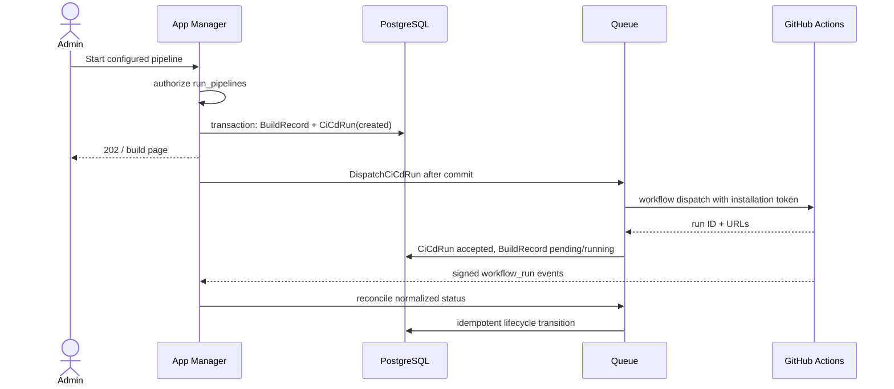

# Integrations: GitHub CI/CD and outbound webhooks — design

**Date:** 2026-07-18

**Status:** Core MVP implemented on `codex/integrations-github-webhooks`

**Planning baseline:** `main` at `0636326`; implementation updated to `main` at `e5b30a8`

**Scope:** team-level Integrations available to Owner and Admin; GitHub Actions is the first CI/CD provider; outbound Webhooks cover application, build, and team-access events.

**Implementation note:** application, app-identifier, credential, build, and
endpoint-test events have transactional producers. Team invitation and member
events are present in the v1 catalog, but their producers remain gated on the
team invitation/member mutation lifecycle, which does not yet exist on `main`.

## Executive decisions

1. **Integrations are team-scoped.** Owner and Admin can configure them. Two
   explicit permissions, `manage_integrations` and `run_pipelines`, keep this
   policy extensible even though both permissions initially map to the same two
   roles.
2. **GitHub uses a GitHub App installation, not PATs.** App Manager stores the
   installation and repository metadata, creates short-lived installation
   access tokens on demand, and never persists those tokens.
3. **GitHub Actions is implemented behind a provider contract.** GitLab,
   Bitbucket, Azure DevOps, Buddy, Bitrise, Travis CI, and Jenkins are not part
   of this MVP, but the domain model must not encode GitHub-specific behavior in
   controllers or build lifecycle code.
4. **A pipeline configuration binds an external workflow to an App Manager
   application.** It may optionally narrow the target to an app identifier and
   stores the default ref, profile, and non-secret input defaults.
5. **`BuildRecord` remains the canonical application build.** A separate
   `CiCdRun` stores the provider execution and dispatch state, so provider
   retries and future re-runs do not distort the application build model.
6. **User-configured Webhooks are outbound notifications.** They are separate
   from the inbound GitHub App webhook used to reconcile workflow runs.
7. **Outbound events use a transactional outbox.** An immutable event is
   written in the same database transaction as the domain change, then queued
   deliveries fan out to subscribed endpoints after commit.

## Problem and goals

App Manager can describe mobile applications, their identifiers, credentials,
and build context, but it cannot start the customer's existing CI pipeline or
notify another system when team data changes.

The MVP must let an Owner or Admin:

- connect a GitHub organization or user installation to a team;
- discover allowed repositories and workflows;
- configure a GitHub Actions workflow as a build pipeline for an application;
- start and cancel a build from App Manager;
- see the provider run link and reconciled status;
- create, edit, rotate, test, disable, and delete outbound webhook endpoints;
- select the application, build, invitation, and membership events delivered
  to each endpoint;
- inspect delivery attempts and manually redeliver a failed delivery.

## Explicit non-goals for the MVP

- Other CI/CD providers.
- Editing workflow YAML or managing GitHub repository secrets.
- Accepting arbitrary secret values as workflow inputs. Workflows must resolve
  secrets in the CI provider.
- Starting pipelines on push, schedules, or arbitrary App Manager events.
- Streaming GitHub job logs or proxying artifacts through App Manager.
- Custom webhook payload transformations, custom HTTP headers, mTLS, or an
  inbound generic-webhook automation engine.
- Automatic GitHub App uninstallation when a team disconnects an integration.
- Guaranteed global webhook ordering. Consumers use event timestamps,
  aggregate IDs, and delivery IDs for idempotency.

## Baseline and dependency gates

The selected `main` baseline has a `team_user.role` string with `owner/member`,
but no production Admin role, integration permission, invitation lifecycle, or
canonical build record. Parallel work in the repository is introducing ACL and
build lifecycle concepts, but it is not committed to `main` and cannot be a
hard dependency by filename or exact schema yet.

Before feature work is merged, the team must land or reconcile these contracts:

1. `TeamRole::Owner` and `TeamRole::Admin` exist and fail closed for unknown
   roles.
2. Team policies expose `manage_integrations` and `run_pipelines`.
3. `BuildRecord` has idempotent lifecycle transitions and belongs to a team,
   mobile app, app identifier, and requesting user.
4. Cancellation distinguishes **cancel requested** from the provider-confirmed
   terminal `cancelled` state.
5. Invitation acceptance and member removal are explicit application-service
   operations, so events can be emitted after successful transactions.

The integration branch should rebase after those foundations merge. If they do
not merge first, Task 0 in the implementation plan adds the minimum contracts
without copying uncommitted implementations from another worktree.

## Authorization

| Capability | Owner | Admin | Contributor | Viewer |
|---|---:|---:|---:|---:|
| Open Integrations settings | yes | yes | no | no |
| Connect/disconnect GitHub | yes | yes | no | no |
| Create/edit/delete pipeline configuration | yes | yes | no | no |
| Start/cancel an integrated build | yes | yes | no | no |
| Manage outbound webhook endpoints | yes | yes | no | no |
| View endpoint secrets or delivery payloads | yes | yes | no | no |

Existing build-history read policy may continue to expose a generic build
status to other roles, but it must not expose installation details, pipeline
configuration, request inputs, webhook payloads, or signing secrets.

All web and JSON endpoints enforce policies server-side. Inertia permissions
only control presentation and are not an authorization boundary.

## Domain model

### `integrations`

Common team-owned lifecycle record:

- `id` UUID, `team_id` UUID;
- `kind`: `ci_cd` or `webhook`;
- `provider`: initially `github` or `http`;
- `name`;
- `status`: `pending`, `active`, `degraded`, `disabled`, `disconnected`;
- `external_id`: GitHub installation ID when applicable;
- `external_account_id`, `external_account_name`;
- `settings` JSON for non-secret provider metadata;
- `created_by_user_id`, `updated_by_user_id`;
- `last_synced_at`, `disabled_at`, `disconnected_at`, timestamps, soft delete.

Index `(team_id, kind, provider)` and enforce uniqueness of an active GitHub
installation per team with `(team_id, provider, external_id)`. The same GitHub
installation may be attached to different App Manager teams only when an
authorized user completes the connection flow for each team.

### `ci_cd_pipelines`

- `id`, `team_id`, `integration_id`, `mobile_app_id`;
- optional `app_identifier_id` constrained to the selected mobile app;
- `name`, `profile_type`, `enabled`;
- provider resource snapshot: `repository_id`, `repository_full_name`,
  `workflow_id`, `workflow_name`, `workflow_path`;
- `default_ref`;
- encrypted JSON `input_defaults`; UI and validation state clearly that inputs
  are configuration, not a secret store;
- `created_by_user_id`, `updated_by_user_id`, timestamps, soft delete.

Repository and workflow IDs are canonical; names and paths are snapshots for
display. A sync refreshes snapshots and marks a pipeline unavailable instead of
silently rebinding it when a workflow disappears.

GitHub requires a manually dispatched workflow file to exist on the repository
default branch. Validate `workflow_dispatch` there when configuring a pipeline.
For a non-default run ref, inspect the same workflow at that ref as well so the
launch form and input validation match the version GitHub will execute.

### `ci_cd_runs`

- `id`, `team_id`, `build_record_id`, `pipeline_id`, `integration_id`;
- `requested_by_user_id`;
- `dispatch_status`: `created`, `dispatching`, `accepted`, `unknown`, `failed`;
- provider `external_run_id`, `external_run_url`, raw status and conclusion;
- immutable request snapshot containing ref and **redacted/non-secret** inputs;
- `dispatched_at`, `last_synced_at`, timestamps.

For MVP, one `CiCdRun` is active per `BuildRecord`. The table boundary allows a
future re-run attempt without adding more GitHub fields to `BuildRecord`.
`BuildRecord.status` is canonical for product behavior; provider fields are
evidence used by the lifecycle service to advance it.

### `webhook_endpoints`

- `id`, `team_id`, `integration_id`;
- HTTPS `url`;
- encrypted signing `secret` plus a non-sensitive hint;
- versioned `subscribed_events` array;
- `enabled`, `failure_count`, `last_success_at`, `last_failure_at`;
- timestamps, soft delete.

### `webhook_events` (transactional outbox)

- event UUID, team ID, event type, schema version;
- aggregate type and ID;
- actor type and ID where present;
- immutable sanitized payload and `occurred_at`;
- `published_at` and timestamps.

The row is inserted inside the domain transaction. A publisher creates one
delivery per active subscribed endpoint using a unique `(event_id,
endpoint_id)` constraint.

### `webhook_deliveries`

- delivery UUID, event ID, endpoint ID;
- immutable payload snapshot and signature version;
- state, attempt count, next attempt time;
- last HTTP status, duration, truncated response body, error category;
- optional `redelivery_of_id` for an intentional manual replay;
- delivered, exhausted, and timestamps.

Retries always use the original serialized payload. They never regenerate an
event from a newer model state.

## Provider boundary

Application code depends on a `CiCdProvider` contract, resolved by a
`CiCdProviderRegistry`:

```text
repositories(connection) -> Repository[]
pipelines(connection, repository) -> Pipeline[]
refs(connection, repository) -> Ref[]
dispatch(connection, pipeline, ref, inputs) -> ProviderRun
cancel(connection, providerRun) -> CancelResult
status(connection, providerRun) -> ProviderRunStatus
```

Provider DTOs contain stable IDs, display metadata, URLs, and normalized
statuses. Controllers and jobs never branch on `provider === 'github'`.

GitHub-specific classes own JWT generation, installation tokens, REST headers,
pagination, rate-limit/error mapping, and webhook payload translation.

## GitHub App design

### App configuration

One GitHub App is registered per App Manager deployment. Secrets live in the
deployment secret manager/environment, not in team database rows:

- GitHub App ID and client ID;
- client secret used only for user authorization during connection;
- private key used to mint App JWTs;
- webhook secret;
- callback, setup, and webhook URLs.

Requested repository permissions:

- **Actions: read/write** — list workflows, dispatch, read, and cancel runs;
- **Contents: read** — list refs and optionally inspect the selected workflow's
  `workflow_dispatch` input declaration;
- **Metadata: read** — GitHub App baseline repository metadata.

Subscribed events:

- `workflow_run`;
- automatic `installation` and `installation_repositories` lifecycle events.

Pin the REST header in configuration (`X-GitHub-Api-Version`, currently
`2026-03-10`) and review it deliberately during upgrades.

### Connection flow

1. Owner/Admin starts connection for a team.
2. App Manager stores an expiring, single-use state/nonce bound to team and
   local user, then redirects to the GitHub App install/authorization flow.
3. GitHub returns an installation ID and authorization code.
4. App Manager exchanges the code for a short-lived GitHub user access token,
   lists installations accessible to that user, and verifies the returned
   installation ID is in that list.
5. App Manager reads installation/account metadata, stores the integration,
   discards the user token, and redirects to repository selection.

The setup URL's `installation_id` is never trusted by itself. A forged ID must
not attach another customer's installation to a team.

### Dispatch flow



The current GitHub API returns the workflow run ID and URLs from workflow
dispatch. Store them immediately. A queue timeout after GitHub accepted the
request is still ambiguous: mark `dispatch_status=unknown`, reconcile, and do
not automatically dispatch a second workflow. An Owner/Admin may explicitly
retry only after the unknown attempt is resolved or abandoned.

### Status and cancellation

- Validate GitHub webhook HMAC over the raw body before JSON parsing.
- Deduplicate by `X-GitHub-Delivery`.
- Return quickly and process on the queue.
- Match runs by provider run ID and repository, then verify installation and
  pipeline ownership before transitioning a build.
- Normalize `requested/queued/in_progress/completed` and conclusion values to
  App Manager build states through the build lifecycle service.
- On cancel, first record `cancel_requested`, then call GitHub. The build only
  becomes `cancelled` after GitHub confirms a terminal cancelled conclusion or
  reconciliation verifies it.
- Webhooks provide low latency; a scheduled reconciliation job is the recovery
  mechanism for missed, delayed, or out-of-order deliveries.
- Installation suspension/deletion marks integrations and pipelines unusable
  without deleting historical builds.

## Outbound webhook contract

### Event catalog v1

| Area | Events |
|---|---|
| Mobile application | `mobile_app.created`, `mobile_app.updated`, `mobile_app.deleted` |
| App identifier | `app_identifier.created`, `app_identifier.updated`, `app_identifier.deleted` |
| Credential | `credential.created`, `credential.updated`, `credential.deleted` |
| Build | `build.created`, `build.started`, `build.cancel_requested`, `build.completed` |
| Team access | `team.invitation.created`, `team.invitation.accepted`, `team.invitation.revoked`, `team.member.role_changed`, `team.member.removed` |
| Endpoint test | `webhook.test` (sent only on explicit test, not subscribable) |

`build.completed` is emitted exactly once on entry to any terminal status and
contains `status=completed|failed|cancelled`; consumers do not need to subscribe
to a growing list of terminal event names.

For updates, payloads contain a safe object projection and a list/map of changed
public fields. Delete events contain a tombstone projection captured before
deletion. Credential events never contain credential payload values, uploaded
file contents, download URLs, private metadata, CI inputs, access tokens, or
webhook secrets. A credential projection is limited to identifiers, name, type,
attachment IDs, expiry metadata, and timestamps.

### Envelope

```json
{
  "id": "evt_uuid",
  "type": "mobile_app.updated",
  "schema_version": 1,
  "occurred_at": "2026-07-18T12:34:56.123Z",
  "team_id": "team_uuid",
  "actor": { "type": "user", "id": "user_uuid" },
  "data": {
    "object": { "id": "app_uuid", "name": "Example" },
    "changes": { "name": { "from": "Old", "to": "Example" } }
  }
}
```

The exact object projections are documented as JSON Schema fixtures before the
first endpoint ships. Additive fields may be introduced within schema version
1; removals, renames, or semantic changes require a new version.

### Delivery and signing

Requests use `POST`, `Content-Type: application/json`, no redirects, and:

- `User-Agent: AppManager-Webhooks/1.0`;
- `X-App-Manager-Event: <event type>`;
- `X-App-Manager-Delivery: <delivery UUID>`;
- `X-App-Manager-Timestamp: <unix seconds>`;
- `X-App-Manager-Signature: v1=<hex HMAC-SHA256>`.

The signature input is `<timestamp>.<raw request body>`. Consumers reject stale
timestamps and deduplicate delivery UUIDs. The 32-byte random endpoint secret
is shown once and encrypted at rest. Rotation generates and reveals a new
secret; the UI warns that rotation takes effect immediately in MVP.

Any 2xx response is successful. Non-2xx responses and network errors retry with
backoff (initial attempt, 1 minute, 5 minutes, 30 minutes, 2 hours, 12 hours,
24 hours). `410 Gone` disables the endpoint. Exhausted deliveries remain
available for manual redelivery. Automatic attempts retain the delivery UUID so
consumer deduplication is safe. An explicit manual redelivery creates a new
delivery UUID, links `redelivery_of_id`, and retains the original event body.

## Security requirements

### GitHub inbound webhook

- Verify `X-Hub-Signature-256` against the raw body with constant-time compare.
- Reject missing/invalid signatures before parsing or queueing.
- Deduplicate delivery IDs with a database unique constraint.
- Limit request size and log payload IDs, never the full unredacted body.

### Outbound HTTP / SSRF

- HTTPS only in production; an explicit development override may allow HTTP.
- Resolve and validate DNS at creation **and delivery time**.
- Block loopback, link-local, private, multicast, reserved, cloud metadata, and
  internal IPv4/IPv6 destinations.
- Do not follow redirects. A future redirect feature must revalidate every hop.
- Apply connection and total timeouts, response-size caps, and per-team rate and
  concurrency limits.
- Store at most a small truncated response preview and never persist response
  cookies or authorization headers.

### Secrets and sensitive data

- GitHub private key, client secret, and inbound webhook secret stay in the
  deployment secret store.
- Mint installation tokens per job and do not persist them.
- Encrypt endpoint signing secrets and pipeline input defaults at rest.
- Redact secrets from exceptions, logs, audit records, and delivery payloads.
- Audit integration create/update/disconnect, pipeline run/cancel, endpoint
  secret rotation, and manual redelivery with actor and team IDs.

## UI and routes

### Integrations settings

`/accounts/{team:slug}/integrations` is a new Owner/Admin-only navigation item
with two sections:

- **CI/CD:** GitHub connection cards, installation health, repository access,
  configured pipelines, connect/sync/disconnect actions.
- **Webhooks:** endpoints, event subscriptions, signing-secret lifecycle,
  health, test action, delivery history, and manual redelivery.

### Application build entry point

The application detail page gets a **Run build** action for Owner/Admin when at
least one enabled pipeline matches the application/identifier. The launch form
selects pipeline, ref, and declared non-secret inputs. After submit it navigates
to the existing build detail/history UI, which shows normalized status and a
direct GitHub run link.

### Endpoint families

- authenticated team web routes for the Inertia settings and actions;
- optional `/api/v1/{team}/integrations/...` JSON resources only if external
  automation is required in this milestone;
- unauthenticated but signed/state-bound GitHub callback/setup routes;
- unauthenticated `POST /webhooks/github`, protected by GitHub HMAC rather than
  session or Sanctum middleware.

The MVP should not expose configuration writes through API tokens unless a new
Sanctum ability and the same Owner/Admin semantics are designed explicitly.

## Observability and operations

- Structured logs include team, integration, pipeline, build, run, event, and
  delivery IDs, never secrets.
- Metrics: connection failures, GitHub API latency/rate limits, dispatch
  accepted/unknown/failed, reconciliation lag, webhook queue lag, delivery
  success rate, attempts, and exhausted deliveries.
- Queue separation: `integrations` for provider calls and `webhooks` for
  outbound deliveries, so a failing customer endpoint cannot delay build
  dispatch.
- Scheduled jobs reconcile non-terminal GitHub runs, expire connection state,
  and republish stranded outbox rows.
- Retain build/provider run history according to build retention. Retain
  delivery payloads and response previews for a shorter configurable window
  (proposed default: 30 days).

## Rollout

1. Feature flag `integrations.enabled` for the whole area.
2. Separate flags `integrations.github.enabled` and
   `integrations.webhooks.enabled` permit staged delivery.
3. Internal team dogfood with a dedicated GitHub App registration.
4. Validate dispatch, cancellation, installation suspension, webhook replay,
   SSRF blocking, and queue recovery in staging.
5. Enable for selected teams, then general Owner/Admin access.

## MVP acceptance criteria

- Contributor and Viewer receive 403 for every integration management and run
  action, even when calling routes directly.
- An Owner/Admin can connect only a GitHub App installation they can access.
- Repository/workflow selection is limited to the installation's allowed
  repositories and workflows with `workflow_dispatch`.
- One UI action creates one local build and one accepted GitHub run; ambiguous
  dispatch never auto-duplicates a run.
- GitHub run start, completion, failure, and cancellation converge to the
  correct idempotent `BuildRecord` status after duplicate/out-of-order events.
- Disconnect/suspend disables new dispatches without deleting history.
- Domain mutation and webhook outbox event commit atomically.
- Webhook payloads contain no credential or provider secrets.
- Webhook signatures verify against published fixtures; replay IDs are stable
  across retries.
- Private/local/reserved webhook destinations are rejected at validation and
  again at delivery.
- Failed deliveries retry, become exhausted, appear in history, and can be
  manually redelivered by Owner/Admin.

## Official GitHub references

- [Workflow endpoints and workflow dispatch](https://docs.github.com/en/rest/actions/workflows)
- [Workflow dispatch syntax and inputs](https://docs.github.com/en/actions/reference/workflows-and-actions/workflow-syntax#onworkflow_dispatch)
- [Workflow run endpoints and cancellation](https://docs.github.com/en/rest/actions/workflow-runs)
- [GitHub App installation endpoints](https://docs.github.com/en/rest/apps/installations)
- [GitHub App setup URL security](https://docs.github.com/en/apps/creating-github-apps/registering-a-github-app/about-the-setup-url)
- [GitHub webhook events and payloads](https://docs.github.com/en/webhooks/webhook-events-and-payloads)
- [Validating GitHub webhook deliveries](https://docs.github.com/en/webhooks/using-webhooks/validating-webhook-deliveries)
